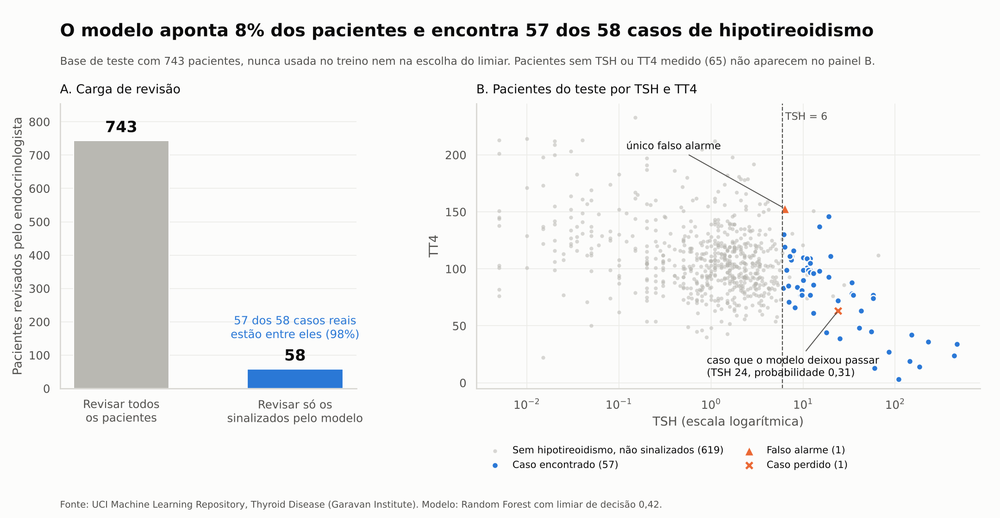

# Triagem de hipotireoidismo com exames de laboratório

Projeto de Parceria EBAC e Semantix, trilha de Cientista de Dados.

Um laboratório recebe todos os dias resultados de exames de tireoide e precisa decidir quais pacientes vão para confirmação com o endocrinologista. Este projeto treina um modelo de classificação que ordena os pacientes por probabilidade de hipotireoidismo, para priorizar essa fila de revisão.



Na base de teste (743 pacientes, 58 com hipotireoidismo), o modelo sinalizou 58 pacientes, encontrou 57 dos 58 casos e teve 1 falso alarme. Revisar todos os pacientes pediria 743 revisões.

## O problema e por que usar dados

Hipotireoidismo é a produção insuficiente de hormônios pela tireoide. É tratável, e o risco está em não identificar o caso. Revisar todos os resultados consome tempo do especialista, e deixar um caso passar deixa uma pessoa sem tratamento.

Os resultados chegam em volume e combinam vários sinais ao mesmo tempo: TSH, T3, TT4, T4U e FTI, uso de medicação e exames que faltam em parte dos pacientes. Um modelo transforma esses sinais em uma probabilidade por paciente, e a equipe escolhe o ponto de corte de acordo com a capacidade de revisão.

O projeto também mostra um limite dessa abordagem. Uma árvore de decisão de profundidade 3 chega perto do modelo (ver Conclusões), e isso pesa na recomendação.

## Estrutura do repositório

```
.
├── README.md
├── requirements.txt
├── data/
│   ├── hypothyroid.csv            base original, sem alterações
│   └── README.md                  origem e observações sobre a base
├── notebooks/
│   └── hipotireoidismo_triagem.ipynb   projeto completo, executado
├── figures/
│   └── resultado_final.png        visualização dos resultados
└── resultados/
    └── metricas_teste.json        métricas na base de teste
```

## Como reproduzir

```bash
pip install -r requirements.txt
cd notebooks
jupyter nbconvert --to notebook --execute --inplace hipotireoidismo_triagem.ipynb
```

O notebook lê `../data/hypothyroid.csv`, usa semente aleatória 42 em todas as etapas e regrava a figura e as métricas. A execução completa leva alguns minutos, a maior parte na busca de hiperparâmetros.

## Coleta de dados

**Fonte.** UCI Machine Learning Repository, base Thyroid Disease, arquivo `hypothyroid`, com registros do Garavan Institute (Sydney, Austrália) doados por Ross Quinlan. A fonte é pública e a base não traz identificação pessoal dos pacientes: https://archive.ics.uci.edu/dataset/102/thyroid+disease

**Conteúdo.** 3.772 pacientes e 30 colunas: idade, sexo, exames (TSH, T3, TT4, T4U, FTI), indicadores clínicos (uso de tiroxina, cirurgia de tireoide, gravidez, entre outros), a origem do encaminhamento e o rótulo `binaryClass`.

**Problemas encontrados e como foram tratados**

| Problema | Tratamento |
|---|---|
| Rótulo invertido: `N` é o paciente com hipotireoidismo (TSH mediano de 12,0 contra 1,2 em `P`) | Alvo criado de forma explícita, `alvo = 1` para hipotireoidismo |
| Ausentes escritos como `?` (6.064 células) | Lidos como ausentes na leitura do arquivo |
| Idade de 455 anos | Trocada por ausente |
| Coluna `TBG` 100% vazia | Removida junto com `TBG measured` |
| 61 linhas duplicadas, todas sem a doença | Removidas antes da divisão em treino e teste |

Depois da limpeza ficam 3.711 pacientes, 291 com hipotireoidismo (7,8%).

**Principais achados da análise exploratória** (sete análises no notebook)

- O alvo é desbalanceado. Um modelo que responde "sem hipotireoidismo" para todos acerta 92% e não encontra ninguém, então a acurácia não serve como métrica principal.
- O TSH é o exame que mais separa as classes (tamanho de efeito de 0,97 no teste de Mann-Whitney), seguido por FTI, TT4 e T3. A idade não diferencia as classes.
- O TSH é muito assimétrico (média 5,1, mediana 1,4, máximo 530), e o log resolve isso para os modelos lineares.
- O FTI é calculado a partir de TT4 e T4U (correlação de 1,00 com TT4/T4U).
- Os ausentes não são aleatórios: nenhum dos 309 pacientes sem TSH medido tem hipotireoidismo. Por isso os indicadores "exame medido" ficaram fora do modelo principal.
- Quem toma tiroxina aparece menos como caso: com TSH acima de 6, 92,4% dos pacientes sem tiroxina são casos contra 14,3% dos que já tomam.

## Modelagem

**Divisão dos dados.** 80% treino e 20% teste, estratificado pelo alvo (2.968 e 743 pacientes, 233 e 58 casos), feita antes de qualquer transformação. Imputação, log, padronização e one-hot ficam dentro de um `Pipeline` com `ColumnTransformer`, então só aprendem com o treino (e, na validação cruzada, só com o treino de cada fold). O teste foi usado uma única vez.

**Comparação de modelos.** Validação cruzada estratificada de 5 folds, só no treino. A métrica principal é a PR-AUC (área sob a curva precisão x recall), que não é inflada pelos 92% de negativos.

| Modelo | Recall | Precisão | PR-AUC |
|---|---|---|---|
| Baseline (sempre "sem hipotireoidismo") | 0,000 | 0,000 | 0,079 |
| Regressão Logística | 0,983 | 0,676 | 0,910 |
| Random Forest | 0,970 | 0,962 | 0,991 |
| XGBoost | 0,974 | 0,958 | 0,974 |

Os três modelos usam peso para a classe rara. Incluir os indicadores "exame medido" mudou a PR-AUC em no máximo 0,001.

**Otimização.** O Random Forest foi para `RandomizedSearchCV` com 30 combinações, mesma validação cruzada, otimizando PR-AUC. Melhores parâmetros: 500 árvores, profundidade máxima 12, `min_samples_leaf` 1 e `max_features` 0,5. A PR-AUC na validação foi de 0,991 para 0,994.

**Limiar de decisão.** Escolhido no treino, com previsões fora da amostra, maximizando o F2 (que pesa o recall mais que a precisão): 0,42.

**Resultado no teste**

| Métrica | Valor | IC 95% (bootstrap) |
|---|---|---|
| Recall | 0,983 | 0,943 a 1,000 |
| Precisão | 0,983 | 0,941 a 1,000 |
| PR-AUC | 0,999 | |

São 57 casos encontrados em 58, 1 falso alarme e 1 caso perdido. Como o teste tem poucos casos, os intervalos são largos.

## Conclusões

**O que o modelo entrega.** Ele aponta cerca de 8% dos pacientes para revisão e encontra 98% dos casos. Na validação cruzada repetida (3 repetições de 5 folds) o resultado é parecido: recall 0,979 (desvio 0,025), precisão 0,976 (desvio 0,020) e PR-AUC 0,993.

**O que isso não prova.** O resultado é bom demais para ser lido como "o modelo diagnostica hipotireoidismo". Uma árvore de profundidade 3, que se lê em poucas linhas, chega a recall 1,0 no teste com precisão de 0,92. Só o TSH em uma regressão logística já dá recall de 0,99 com precisão de 0,64 na validação cruzada. O rótulo parece vir de uma regra aplicada aos mesmos exames que o modelo recebe, e por isso TSH (importância 0,88) e uso de tiroxina (0,16) dominam. Sem um diagnóstico independente dos exames, não dá para afirmar que o modelo generaliza para a prática clínica.

**Recomendação**

1. Usar o modelo como segunda leitura automática dos resultados de laboratório. O ganho é consistência e tempo do especialista, não a descoberta de casos que um médico não veria.
2. Tratar à parte quem já usa tiroxina, porque com TSH alto eles aparecem como casos só 14% das vezes e a conduta ali é ajuste de dose.
3. Pedir o TSH para pacientes que chegam sem ele, principalmente quando há suspeita clínica marcada. O modelo não tem o que avaliar nesses casos.
4. Validar com dados de outra clínica e com um diagnóstico que não dependa desses exames antes de qualquer uso real. A prevalência de 7,8% é de pacientes encaminhados: com 1% de casos, a precisão estimada cai para perto de 0,87.

**Limitações.** Poucos casos (58 no teste), base antiga e de uma única fonte, que o próprio UCI diz poder ter sido corrompida depois da doação. O caso perdido pelo modelo tem TSH de 24 e TT4 baixo (probabilidade 0,31), e não consegui explicar com certeza o motivo.

## Referências

- Dua, D. e Graff, C. UCI Machine Learning Repository, Thyroid Disease. Universidade da Califórnia, Irvine. https://archive.ics.uci.edu/dataset/102/thyroid+disease
- Quinlan, J. R. et al. (1986). Inductive knowledge acquisition: a case study. Proceedings of the Second Australian Conference on Applications of Expert Systems, Sydney.
